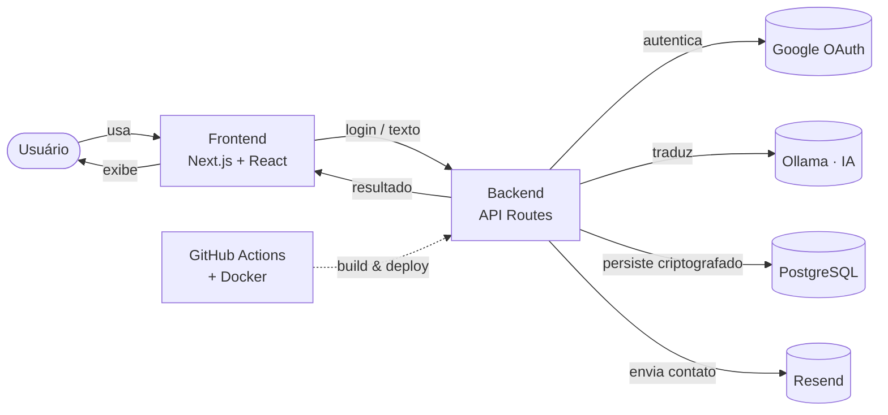

<p align="center">
  
</p>

<h1 align="center">Linkedinsney</h1>

<p align="center">
  <strong>Seu chefe não vai entender. O LinkedIn vai adorar.</strong>
</p>

<p align="center">
  Cole qualquer texto honesto e receba um post corporativo impecável, cheio de buzzwords, propósito e emojis.<br/>
  Ou cole um post do LinkedIn e descubra o que a pessoa <em>realmente</em> quis dizer.
</p>

<p align="center">
  <a href="https://linkedinsney.com/"><strong>Ver demonstração</strong></a>
</p>

<p align="center">
  <a href="https://github.com/ArturMiguel/linkedinsney/actions/workflows/deploy.yml"></a>
  <a href="LICENSE"></a>
  
</p>

---

## Funcionalidades

- **Tradução bidirecional**: transforma um texto honesto em post corporativo do LinkedIn, ou faz o caminho inverso e revela o que a pessoa realmente quis dizer.
- **Linkedômetro**: cada tradução recebe uma pontuação de contaminação corporativa, de "Ser humano real" a "Embaixador(a) do propósito".
- **Login com Google**: necessário pra traduzir, protege a IA contra abuso.
- **Histórico**: reveja suas traduções anteriores quando quiser.
- **Multilíngue**: pt-BR, en-US e es-ES, com tema claro/escuro.
- **Dados criptografados**: e-mails e textos traduzidos ficam protegidos no banco.

## Arquitetura



| Camada (diagrama) | Tecnologia | Papel no projeto |
| --- | --- | --- |
| Frontend | Next.js 16 (App Router) · React 19 · TypeScript · Tailwind CSS · Radix UI / shadcn/ui · React Hook Form · next-intl | Interface, rotas, renderização no servidor, formulário de tradução e idioma (pt-BR/en-US/es-ES) |
| Backend | API Routes (Next.js) · JWT · AES | Autentica a sessão (cookie `httpOnly` com refresh automático), orquestra a tradução e criptografa os dados antes de persistir |
| Google OAuth | Google Identity Services | Verifica a identidade de quem faz login |
| IA | Ollama (self-hosted) | Gera a tradução e a pontuação do Linkedômetro, com guarda contra prompt injection |
| PostgreSQL | Prisma | Guarda usuários e histórico de traduções |
| Resend | API de e-mail transacional | Envia as mensagens do formulário de contato |
| GitHub Actions + Docker | Docker Compose | Builda a aplicação e automatiza o deploy a cada push na `master` |

## Rodando localmente

```bash
git clone https://github.com/ArturMiguel/linkedinsney.git
cd linkedinsney
npm install
cp .env.example .env   # preencha com suas credenciais
npm run migrate
npm run dev
```

Acesse [http://localhost:3000](http://localhost:3000). Requer Node 24+, um Postgres e uma instância [Ollama](https://ollama.com/) com modelo disponível.

Pra rodar com Docker: `docker compose up --build -d` (sobe em `:4005`, ver [docker-compose.yml](docker-compose.yml)).

<details>
<summary>Variáveis de ambiente</summary>

| Variável | Descrição |
| --- | --- |
| `NEXT_PUBLIC_SITE` | URL pública do site. |
| `NEXT_PUBLIC_GOOGLE_OAUTH_CLIENT_ID` | Client ID do OAuth do Google. |
| `DATABASE_URL` / `DATABASE_DIRECT_URL` | Connection strings do Postgres (pooled / direta, para migrations). |
| `JWT_SECRET` | Chave de assinatura dos tokens de sessão. |
| `ENCRYPTION_KEY` | Chave de criptografia dos dados sensíveis. |
| `OLLAMA_API_URL` / `OLLAMA_API_TOKEN` / `OLLAMA_API_MODEL` | Configuração da instância de IA. |
| `RESEND_API_KEY` / `RESEND_FROM_EMAIL` / `RESEND_TO_EMAIL` | Envio de e-mail do formulário de contato. |

Lista completa em [.env.example](.env.example).

</details>

## Licença

MIT, veja [LICENSE](LICENSE). Feito por [Artur Miguel](https://github.com/ArturMiguel) ([LinkedIn](https://www.linkedin.com/in/arturmiguelrocha)).

<p align="center"><sub>Ferramenta independente. Não é afiliada, endossada ou associada à LinkedIn Corporation.</sub></p>
