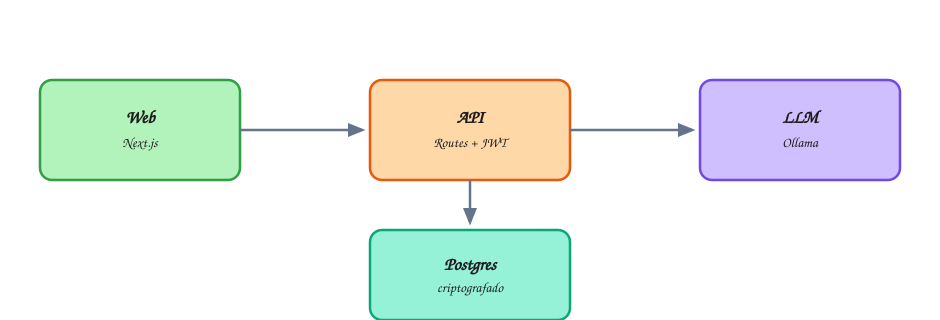

<p align="center">
  
</p>

<h1 align="center">Linkedinsney</h1>

<p align="center">
  <strong>Seu chefe não vai entender. O LinkedIn vai adorar.</strong>
</p>

<p align="center">
  Cole qualquer texto honesto e receba um post corporativo impecável, cheio de buzzwords, propósito e emojis.<br/>
  Ou cole um post do LinkedIn e descubra o que a pessoa <em>realmente</em> quis dizer.
</p>

<p align="center">
  <a href="https://linkedinsney.com/"><strong>Ver demonstração</strong></a>
</p>

<p align="center">
  <a href="https://github.com/ArturMiguel/linkedinsney/actions/workflows/deploy.yml"></a>
  <a href="LICENSE"></a>
  
</p>

> **Na prática:**  
> **Você escreve:** Perdi o cliente porque esqueci de enviar a proposta.  
> **Linkedinsney:** Recentemente, vivi um desafio que me convidou a exercitar a vulnerabilidade e a encarar a perda de uma oportunidade como um catalisador de crescimento 💪 [...]

---

## Funcionalidades

- Traduz nos dois sentidos: de um texto honesto para um post corporativo do LinkedIn, ou o caminho inverso, revelando o que a pessoa realmente quis dizer.
- Cada tradução recebe uma nota de contaminação corporativa no Linkedômetro, de "Ser humano real" a "Embaixador(a) do propósito".
- Login com Google é obrigatório pra traduzir, o que protege a IA contra abuso.
- O histórico de traduções anteriores fica disponível pra consulta.
- Interface em pt-BR, en-US e es-ES, com tema claro e escuro.
- E-mails e textos traduzidos ficam criptografados no banco.

## Como funciona



O front-end em Next.js manda o texto e o modo escolhido (traduzir ou decodificar) pro back-end, autenticado por um cookie `httpOnly` com JWT que se renova automaticamente perto do vencimento. O back-end monta o prompt certo pro modo e chama o Ollama, uma instância de IA self-hosted.

Como o texto do usuário entra direto no prompt do modelo, os dois prompts instruem o Ollama a tratar qualquer comando embutido nesse texto como parte do conteúdo a traduzir. A resposta ainda passa por uma checagem que compara trechos da saída contra os próprios prompts do sistema, e rejeita com erro se detectar vazamento.

No modo traduzir, as últimas cinco traduções do usuário voltam como histórico de conversa pro modelo manter o tom ao longo da sessão. No modo decodificar isso não acontece, e uma segunda chamada ao Ollama calcula a nota do Linkedômetro.

Texto original e traduzido são criptografados com AES antes de ir pro PostgreSQL, então mesmo um acesso direto ao banco não expõe o conteúdo.

## Rodando localmente

```bash
git clone https://github.com/ArturMiguel/linkedinsney.git
cd linkedinsney
npm install
cp .env.example .env   # preencha com suas credenciais
npm run migrate
npm run dev
```

Acesse [http://localhost:3000](http://localhost:3000). Requer Node 24+, um Postgres e uma instância [Ollama](https://ollama.com/) com modelo disponível.

Pra rodar com Docker: `docker compose up --build -d` (sobe em `:4005`, ver [docker-compose.yml](docker-compose.yml)).

<details>
<summary>Variáveis de ambiente</summary>

| Variável | Descrição |
| --- | --- |
| `NEXT_PUBLIC_SITE` | URL pública do site. |
| `NEXT_PUBLIC_GOOGLE_OAUTH_CLIENT_ID` | Client ID do OAuth do Google. |
| `DATABASE_URL` / `DATABASE_DIRECT_URL` | Connection strings do Postgres (pooled / direta, para migrations). |
| `JWT_SECRET` | Chave de assinatura dos tokens de sessão. |
| `ENCRYPTION_KEY` | Chave de criptografia dos dados sensíveis. |
| `OLLAMA_API_URL` / `OLLAMA_API_TOKEN` / `OLLAMA_API_MODEL` | Configuração da instância de IA. |
| `RESEND_API_KEY` / `RESEND_FROM_EMAIL` / `RESEND_TO_EMAIL` | Envio de e-mail do formulário de contato. |

Lista completa em [.env.example](.env.example).

</details>

## Licença

MIT, veja [LICENSE](LICENSE). Feito por [Artur Miguel](https://github.com/ArturMiguel) ([LinkedIn](https://www.linkedin.com/in/arturmiguelrocha)).

<p align="center"><sub>Ferramenta independente. Não é afiliada, endossada ou associada à LinkedIn Corporation.</sub></p>
